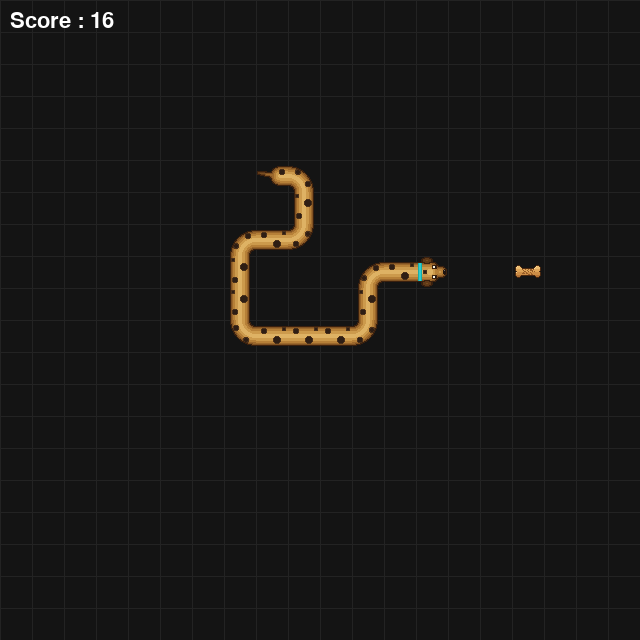

# 🐶 Snakooby (version simple)

Un Snake en Python avec **pygame-ce**, où le serpent est remplacé par un long chien tacheté qui court après des biscuits en forme d'os.
Cette branche garde la boucle de jeu la plus simple possible : **un tour de boucle = une image = un pas d'une case**. Tout le code est commenté en français pour être lisible par un débutant.

> La branche `main` contient la version avec mouvement fluide (affichage à 60 FPS, file d'attente des touches).

<p align="center">
  
  
</p>

## Fonctionnalités

- **Déplacement case par case** : le chien avance d'une case à chaque image, et `GAME_FPS` règle à la fois l'affichage et sa vitesse.
- **Pas de demi-tour direct** : si le chien va à droite, la flèche gauche est ignorée.
- **Graphismes en pixel art** : la tête, le corps, les virages et la queue sont des images tournées automatiquement selon la direction.
- **Menu** avec les boutons Jouer / Quitter, le rappel du dernier score et des raccourcis clavier.
- **Tous les réglages au même endroit** (`constants.py`) : vitesse, taille de la grille, couleurs, images.

## Installation

Il faut Python 3 (testé avec Python 3.15 et pygame-ce 2.5.8).

```bash
git clone https://github.com/Belitharian/Snakooby.git
cd Snakooby
git switch version-simple
pip install pygame-ce
python snake.py
```

> ⚠️ Le paquet s'appelle `pygame-ce`, mais dans le code on écrit `import pygame`.
> N'installe pas `pygame` et `pygame-ce` en même temps : les deux utilisent le nom `pygame` et entrent en conflit.
> Si `pygame` est déjà installé : `pip uninstall pygame`, puis `pip install pygame-ce`.

## Commandes

| Touche | Action |
|---|---|
| Flèches ← ↑ → ↓ | Diriger le chien |
| Entrée | Jouer (depuis le menu) |
| Échap | Quitter (depuis le menu) |
| Clic souris | Boutons du menu |

La partie se termine quand le chien touche un mur ou se mord lui-même. Chaque biscuit rapporte 1 point et le fait grandir d'une case.

## Réglages

Tout se change dans `constants.py`, sans toucher au reste du code :

| Constante | Rôle | Valeur par défaut |
|---|---|---|
| `GAME_FPS` | Pas par seconde pendant la partie (vitesse du chien) | `8` |
| `MENU_FPS` | Images par seconde du menu | `30` |
| `CELL_SIZE` | Taille d'une case en pixels | `32` |
| `GRID_WIDTH`, `GRID_HEIGHT` | Taille de la grille en cases | `20`, `20` |
| `START_CELL` | Case de départ de la tête (colonne, ligne) | `(10, 10)` |
| `TITLE` | Nom affiché dans la fenêtre et le menu | `"Snake"` |

## Organisation du projet

```
├── snake.py        # Point d'entrée : fenêtre, boucle de jeu, déplacement, affichage
├── menu.py         # Écran d'accueil (boutons Jouer / Quitter)
├── constants.py    # Tous les réglages : grille, couleurs, vitesses, chemins des images
├── assets/         # Images : biscuit, tête, corps, virage, queue
└── docs/           # Captures d'écran du README
```

## Comment ça marche (en bref)

- **Le serpent est une liste de positions en pixels**, la tête en premier. Pour avancer, une nouvelle tête est ajoutée devant (`insert`) et le bout de la queue est retiré (`pop`). Pour grandir, la queue n'est simplement pas retirée.
- **La vitesse = le nombre de tours de boucle par seconde.** `clock.tick(GAME_FPS)` met le jeu en pause juste ce qu'il faut ; comme le chien avance d'une case par tour, changer `GAME_FPS` change sa vitesse.
- **Les collisions se font case par case** : il suffit de comparer des positions. La queue libère sa case pendant le tour, ce qui permet au chien de suivre sa propre queue (sauf s'il mange : la queue reste alors en place).
- **La nourriture n'apparaît jamais sur le chien** : une case est tirée au hasard jusqu'à en trouver une libre.
- **Quatre images suffisent** (tête, corps droit, virage, queue). Chacune est tournée de 0°, 90°, 180° ou 270° selon la position des cases voisines.

L'en-tête de `snake.py` explique plus en détail le choix de pygame-ce, l'organisation en modules et les fonctionnalités principales.
