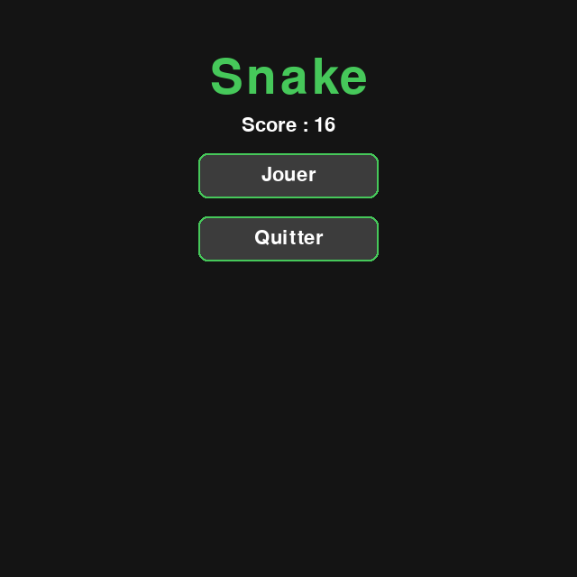

# 🐶 Snakooby

Un Snake en Python avec **pygame-ce**, où le serpent est remplacé par un long chien tacheté qui court après des biscuits en forme d'os.
Le mouvement est fluide, les commandes sont réactives, et tout le code est commenté en français pour être lisible par un débutant.

<p align="center">
  
  
</p>

## Fonctionnalités

- **Mouvement fluide** : l'écran est redessiné 60 fois par seconde et le chien glisse d'une case à l'autre au lieu de sauter.
- **Commandes réactives** :
  - les flèches appuyées très vite sont gardées en file d'attente, il est donc impossible de faire demi-tour par erreur ;
  - un « coup de pouce » fait tourner dans la case où l'on voit la tête, même si la touche arrive un peu en retard.
- **Graphismes en pixel art** : la tête, le corps, les virages et la queue sont des images tournées automatiquement selon la direction.
- **Menu** avec les boutons Jouer / Quitter, le rappel du dernier score et des raccourcis clavier.
- **Tous les réglages au même endroit** (`constants.py`) : vitesse, taille de la grille, couleurs, images.

## Installation

Il faut Python 3 (testé avec Python 3.15 et pygame-ce 2.5.8).

```bash
git clone https://github.com/Belitharian/Snakooby.git
cd Snakooby
pip install pygame-ce
python snake.py
```

> ⚠️ Le paquet s'appelle `pygame-ce`, mais dans le code on écrit `import pygame`.
> N'installe pas `pygame` et `pygame-ce` en même temps : les deux utilisent le nom `pygame` et entrent en conflit.
> Si `pygame` est déjà installé : `pip uninstall pygame`, puis `pip install pygame-ce`.

## Commandes

| Touche | Action |
|---|---|
| Flèches ← ↑ → ↓ | Diriger le chien |
| Entrée | Jouer (depuis le menu) |
| Échap | Quitter (depuis le menu) |
| Clic souris | Boutons du menu |

La partie se termine quand le chien touche un mur ou se mord lui-même. Chaque biscuit rapporte 1 point et le fait grandir d'une case.

## Réglages

Tout se change dans `constants.py`, sans toucher au reste du code :

| Constante | Rôle | Valeur par défaut |
|---|---|---|
| `SNAKE_SPEED` | Cases parcourues par seconde (vitesse du chien) | `8` |
| `FPS` | Images affichées par seconde | `60` |
| `CELL_SIZE` | Taille d'une case en pixels | `32` |
| `GRID_WIDTH`, `GRID_HEIGHT` | Taille de la grille en cases | `20`, `20` |
| `TURN_GRACE` | Durée du « coup de pouce » pour tourner (0 = désactivé) | `0.35` |
| `MAX_QUEUED_KEYS` | Nombre de flèches gardées en attente | `2` |
| `TITLE` | Nom affiché dans la fenêtre et le menu | `"Snake"` |

## Organisation du projet

```
├── snake.py        # Point d'entrée : fenêtre, boucle de jeu, déplacement, affichage
├── menu.py         # Écran d'accueil (boutons Jouer / Quitter)
├── constants.py    # Tous les réglages : grille, couleurs, vitesses, chemins des images
├── assets/         # Images : biscuit, tête, corps, virage, queue
└── docs/           # Captures d'écran du README
```

## Comment ça marche (en bref)

- **Le serpent est une liste de cases**, la tête en premier. Pour avancer, une nouvelle tête est ajoutée devant et le bout de la queue est retiré. Pour grandir, la queue n'est simplement pas retirée.
- **La logique et l'affichage sont séparés.** Le chien change de case `SNAKE_SPEED` fois par seconde, mais l'écran est redessiné `FPS` fois par seconde. Entre deux pas, la tête et la queue glissent de quelques pixels, tandis que le corps reste sur ses cases.
- **Les collisions se font case par case** : il suffit de comparer des positions. La queue libère sa case pendant le pas, ce qui permet au chien de suivre sa propre queue.
- **Quatre images suffisent** (tête, corps droit, virage, queue). Chacune est tournée de 0°, 90°, 180° ou 270° selon la position des cases voisines.

L'en-tête de `snake.py` explique plus en détail le choix de pygame-ce, l'organisation en modules et les fonctionnalités principales.
